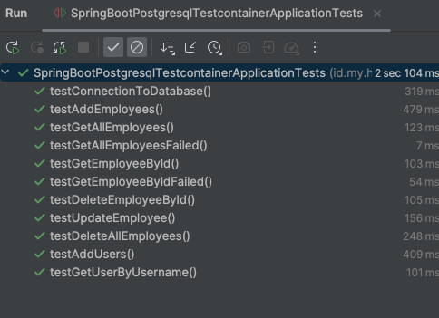

# spring-boot-postgresql-testcontainer

[](https://github.com/hendisantika/spring-boot-postgresql-testcontainer/actions/workflows/maven.yml)


Sample Spring Boot REST API secured with Spring Security, backed by PostgreSQL, and integration-tested with
[Testcontainers](https://testcontainers.com/).

## Tech Stack

- Java 25
- Spring Boot 4.1 (Web MVC, Data JPA, Security, Actuator, Docker Compose support)
- PostgreSQL
- Testcontainers 2.x (`testcontainers-postgresql`, `testcontainers-junit-jupiter`)
- Lombok
- Maven (wrapper included)

## Prerequisites

- JDK 25
- Docker (required by Testcontainers and Docker Compose)

## Getting Started

1. Clone this repository:
   ```shell
   git clone https://github.com/hendisantika/spring-boot-postgresql-testcontainer.git
   ```
2. Navigate to the folder:
   ```shell
   cd spring-boot-postgresql-testcontainer
   ```
3. Run the application (PostgreSQL & pgAdmin are started automatically from `compose.yaml` via Spring Boot Docker
   Compose support):
   ```shell
   ./mvnw clean spring-boot:run
   ```
4. Run the tests (a throwaway `postgres:18-alpine` container is started by Testcontainers):
   ```shell
   ./mvnw clean verify
   ```

## API Endpoints

| Method   | Endpoint                 | Access                  |
|----------|--------------------------|-------------------------|
| `POST`   | `/api/v1/user`           | Public (register user)  |
| `GET`    | `/api/v1/user`           | Public                  |
| `GET`    | `/api/v1/employees`      | `ROLE_ADMIN`            |
| `GET`    | `/api/v1/employees/{id}` | `ROLE_USER`             |
| `POST`   | `/api/v1/employees`      | Authenticated           |
| `PUT`    | `/api/v1/employees`      | Authenticated           |
| `DELETE` | `/api/v1/employees`      | Authenticated           |
| `DELETE` | `/api/v1/employees/{id}` | Authenticated           |

Actuator endpoints are exposed under `/actuator`.

## Continuous Integration

GitHub Actions (`.github/workflows/maven.yml`) builds and tests the project on JDK 25 (Temurin) for every push and
pull request to `main`, using the Docker engine on the GitHub-hosted runner for Testcontainers.

Dependabot (`.github/dependabot.yml`) keeps Maven dependencies, GitHub Actions, and Docker Compose images up to date
with grouped pull requests.

## Test Result


